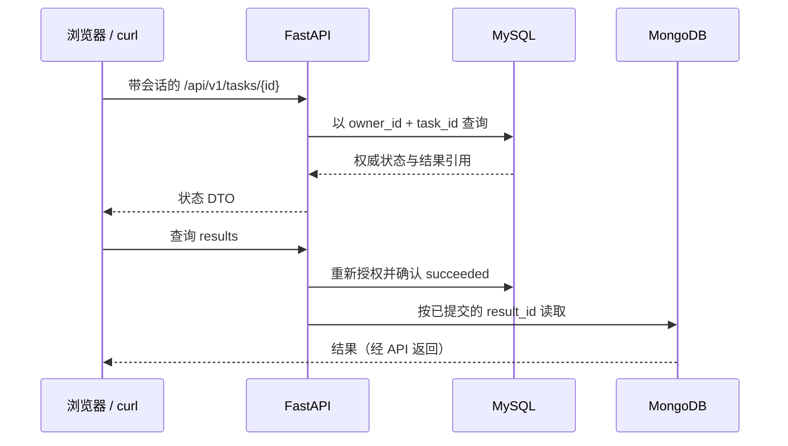
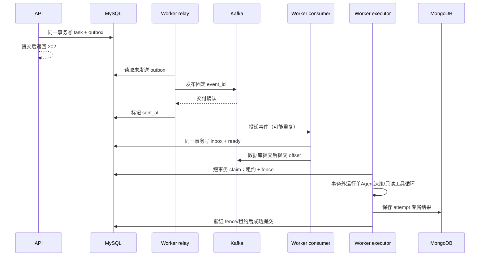

# 架构：先看一次任务，再看组件

> 当前已实现可靠后端、可选学习前端/同源网关和受限单Agent运行时，本轮真实Compose与浏览器CI已通过，范围见 [单Agent验收报告](AGENT_TEST_REPORT.md)。默认脚本控制器不调用真实LLM；live仍待私密配置和单独验收。Kubernetes及其他新增外围组件继续延期。初学者可先跟随[单任务导读](AGENT_WALKTHROUGH.md)，再展开本页。

## 先不用任何高级术语

假设用户提交“总结这段文字”。最开始，API可以直接处理并返回：代码短，但任务一慢，请求会长时间等待；进程一停，未保存的工作就不见了。

| 遇到的问题 | 引入什么 | 新增代价 |
|---|---|---|
| 刷新或重启后找不到任务 | MySQL任务表 | 要设计表、事务、索引和迁移 |
| 用户不想一直等处理完成 | Worker后台执行＋202取任务号 | 要查询状态，处理后台失败 |
| 接单进程和干活进程要传递任务 | Kafka消息交付 | 要理解重复、顺序、offset和恢复 |
| 结果/步骤形状不固定 | MongoDB文档 | 多了存储和跨库一致性问题；小项目也可先用SQL JSON |
| 临时提示读写频繁 | Redis TTL提示 | 允许过期/丢失，不能把它当唯一账本 |
| 写了任务却没把消息发出去 | SQL内一起保存待发记录（Outbox） | 多了发送与重试模块 |
| 相同消息到达两次 | 记录已收到的event_id（Inbox） | 多了去重表和事务 |
| 干活的人失联，新人接手后旧人又回来 | 有效期（租约）＋递增执行代号（fence） | 多了恢复扫描和提交检查 |

前五行先理解业务职责，后三行再理解失败时如何补救。组件不是万能解法：每加一个都有收益，也有代价。

## 1. 三张图分别回答三个问题

**同步路径：浏览器要立即得到什么？**



后端默认可直接访问8080；可选学习界面通过Nginx同源入口8081访问API，不取代API登录和资源授权。图中省略了结果读取时可降级的Redis缓存，实际仍先SQL授权，再查缓存/回源Mongo。每次结果/事件查询也要检查 owner；知道 UUID 不是访问权限。

**异步路径：谁负责把请求变成结果？**



这不是一个大事务。Kafka 与数据库之间存在窗口，所以采用可重试的小步骤，而不是假装跨系统原子完成。Inbox 先持久化，再 ack，确保 Kafka 认为消息处理完后，执行工作仍存在 MySQL 中。

**部署路径：进程运行在哪里？**

```text
当前 Compose 开发网络
  curl → api（主机8080，内部8000）
  worker：relay + consumer + executor + recovery
  migrate：单次 schema 迁移入口
  mysql / kafka / mongo / redis：各自的数据与开发卷
  可选 compose.ui.yaml：浏览器 → Nginx学习界面/同源API入口8081
  后续另学：完整observability、Kubernetes
```

API 与 Worker 是两个运行入口，不是两套重复业务代码，也不是两个Agent。Worker内部的单控制器负责决策，基础设施负责交付与持久化。Kubernetes 的 Deployment/Service 不会替你处理消息幂等；它只管理进程和访问入口。

## 2. 谁的记录可信

MySQL 保存“任务是什么状态、属于谁、哪次执行有权提交”。MongoDB 保存“这次执行产生了哪些灵活结构的内容”。Kafka 保存“发生过什么事件、消费者读到哪里”。Redis 保存“可过期的提示和不可变结果缓存”。四者不是四份同等权威的任务表。

结果保存采用 MongoDB 先写、MySQL 后提交引用：若前者失败，不得成功；若前者成功而后者前宕机，会留下孤儿文档，但不能对用户展示未提交结果。这是有意选择的失败方向。

## 3. 代码阅读路线（已核对存在的函数）

接口字段始终看 [API_CONTRACT.md](API_CONTRACT.md)，下列链接对应实际源文件，不猜测行号。

| 顺序 | 文件与符号 | 阅读问题 |
|---|---|---|
| 1 | [service.py](../backend/service.py) `TaskService.create` / `same` | 为什么查重后还需要数据库唯一约束？为什么 task 与 outbox 在同一事务？ |
| 2 | 同文件 `relay_once` | 为什么发布确认之后再标记，仍然可能重复？ |
| 3 | 同文件 `receive` | 为什么 inbox 与 ready 要一起提交？重复事件如何处理？ |
| 4 | 同文件 `claim` | 为什么使用短事务和 `SKIP LOCKED`？fence 是什么？ |
| 5 | 同文件 `execute_once` / `finalize` | 为什么模型调用不能占着 SQL 行锁？过期 Worker 如何被拒绝？ |
| 6 | 同文件 `fail_locked` / `recover` | 重试何时发生？租约到期由谁扫出来？ |
| 7 | [domain.py](../backend/domain.py) `TRANSITIONS` / `transition` | 哪些状态转移非法？成功还能被覆盖吗？ |
| 8 | [adapters.py](../backend/adapters.py) `KafkaBus` / `MongoDocuments` / `Model` / `ProgressCache` | 哪些是真网络，哪些是明确的测试替身？ |
| 9 | [db.py](../backend/db.py) 与 [migrate.py](../backend/migrate.py) | 唯一约束、索引和初始 schema 在哪里定义？ |
| 10 | [agent.py](../backend/agent.py) `run_agent` / `ScriptedController.next` | 下一步如何依赖工具观察？为什么脚本分支不等于LLM推理？ |
| 11 | [agent_tools.py](../backend/agent_tools.py) `execute_tool`；[agent_provider.py](../backend/agent_provider.py) `LiveController.next` / `normalize` | 工具如何限定材料与预算？live响应如何归一化？ |

API入口见 [app.py](../backend/app.py) `create_app`，Worker入口见 [worker.py](../backend/worker.py) `main` / `executor`。两个文件已实际核对。不要把每个内部方法画成独立服务。

## 4. 三种幂等不能混为一谈

1. **HTTP 请求幂等**：同用户、同键、同参数得到原任务；同键不同参数报冲突。
2. **事件幂等**：相同 event_id 重投，不再次把终态任务改成 ready。
3. **执行提交幂等/隔离**：只有有效 fence 的尝试能提交成功；不代表模型只执行了一次。

Kafka 生产者幂等减少特定发送重试带来的重复，不覆盖 MySQL/MongoDB/模型调用。Kafka 官方也明确讨论外部系统的协作边界：[交付语义](https://kafka.apache.org/41/design/design/)。

## 5. 当前实现的真实限制

- relay 首轮约定单实例。API 可无状态扩展，不代表整个 Worker 可以随意增加副本。
- 结果 ID 属于 attempt；租约恢复后的新 attempt 可能再次调用模型。旧文档复用、孤儿清理尚需单独实现和验收，不能声称已经做到调用恰好一次。
- `/events` 现在返回MySQL持久化生命周期事件（component/kind/trace_id），不是模型隐藏思维或多工具轨迹；`/agent-steps`读取MongoDB已提交成功结果中的公开工具动作，不是实时流，也不覆盖失败尝试的完整审计。Redis提供TTL300秒不可变结果cache-aside，仍不是任务账本。
- 迁移目前是显式初始版本入口；后续 schema 演进必须追加真实迁移，不能改 `create_all` 就宣称支持升级/回滚。
- 有 trace_id 并不等于有完整分布式 tracing；跨 Kafka 的上下文传播、span 导出与查询必须分别验证。

这些不是需要隐藏的瑕疵，而是下一章实验的边界。参见[故障实验](FAILURE_LABS.md)。


## 6. 一次提交：按实际语句顺序读代码

不固定易过期的行号；打开链接后搜索函数名，按下列顺序逐行对照。

1. [app.py](../backend/app.py) `context`：生成request_id，校验写请求Origin和请求体上限，记录HTTP指标。这里尚未创建任务。
2. `TaskInput.trim`：Pydantic长度校验后trim；纯空白拒绝。验证后的prompt才进入业务。
3. `submit`：`auth.identity(request, write=True)`检查会话与CSRF，再检查幂等键长度；最后调用`runtime.tasks.create(...)`。每一步失败都不能创建任务。
4. [service.py](../backend/service.py) `create`：计算请求摘要；进入session.begin；按owner和key查原任务；不存在则插入task、flush、调用emit写outbox。context manager退出时才提交。并发唯一约束冲突时回滚后读赢家，不能把预查当成唯一保护。
5. [worker.py](../backend/worker.py) `main`：创建真实consumer并禁用自动提交/自动存offset；relay独立线程发布，consumer主循环poll；`receive`成功返回后才同步commit当前message。持久化或commit失败时不继续跨过未处理消息。
6. [service.py](../backend/service.py) `receive`：验证schema/type；Inbox唯一插入；锁任务；仅pending转ready。这几个写操作在同一事务。
7. [worker.py](../backend/worker.py) `executor`：独立线程调用recover再execute_once，长模型调用不阻塞主线程poll。首轮还需遵守单Worker和轮询耗时预算，不盲目扩容。
8. `claim`：锁定ready任务并跳过已被锁住的行；状态转running；递增fence与attempt_count；记录lease_until和Attempt；短事务结束，释放锁。
9. `execute_once`：写可丢弃Redis进度；查当前attempt结果；调用`Model.run`；先保存MongoDB，再调用finalize。`Model.run`选择脚本或live控制器，`run_agent`执行有界决策/只读工具循环；默认scripted_test无真实模型推理，没有任意shell、文件或URL工具。
10. `finalize`：重新锁任务，检查running、fence和有效租约；然后一起写succeeded、result_id及Attempt完成。若检查失败返回false，不允许旧执行器覆盖新结果。
11. HTTP `results`：身份确认后调用`document`，先从SQL确认所有权与成功引用，再读Redis不可变结果缓存；miss/unavailable/disabled才回源MongoDB，并返回cache_status。缓存命中可直接返回，Mongo回源不可读则503，而不是假造空成功。

**复述检查**：HTTP响应丢了看幂等键；Kafka重复了看Inbox；Worker过期了看fence；Redis丢了看MySQL；模型响应丢了不能承诺避免再次计费。


### Redis缓存的可观察边界

结果接口先查SQL的所有权和result_id，然后查Redis；缓存miss回源Mongo并写TTL300秒。同一结果引用不可变，避免修改旧结果产生失效竞态。响应`cache_status`可为hit/miss/unavailable/disabled。连读两次通常能看到首次miss、第二次hit，但此前已有读取时第一次也可能hit。停Redis时应unavailable并从Mongo取结果；停MySQL不能靠缓存绕过授权。

### 生命周期记录与尝试记录

`TaskService.events`读取MySQL TaskEvent，每次真实事务落库时记录pending/outbox_sent/ready/running等kind，以及api/relay/consumer/executor/recovery组件。`attempts`读取Attempt，观察fence和outcome。二者都先检查owner；它们帮助看懂后台，不是完整OpenTelemetry trace。
